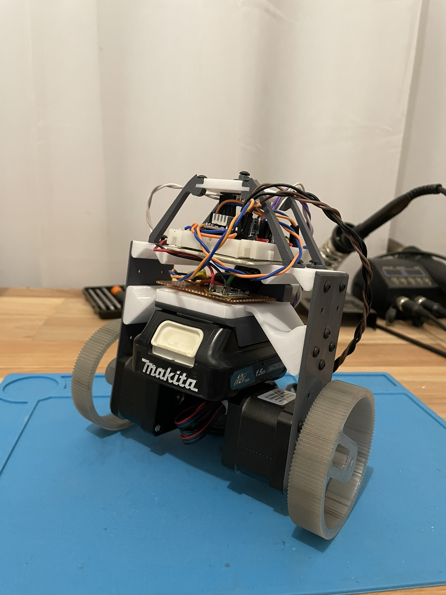
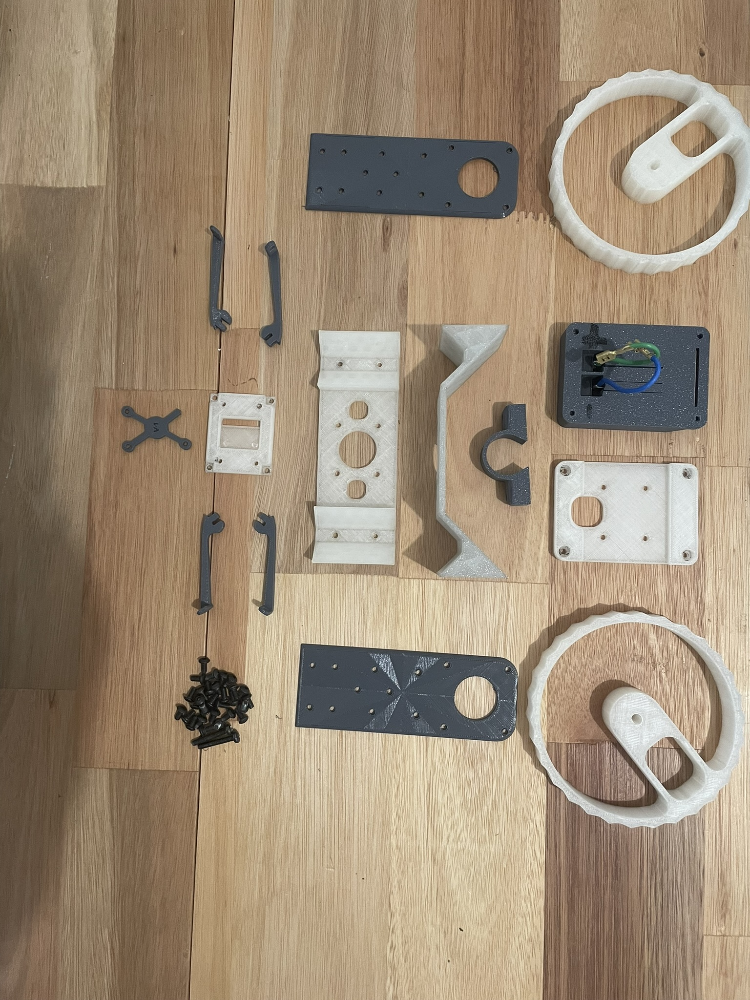

# S.B.R — Self Balancing Robot

Robô autoequilibrante de duas rodas: ESP32-C3 + MPU6050 + 2× NEMA17 com DRV8825 (1/16), bateria Makita 12 V.
Controle em cascata (equilíbrio, velocidade e curva) a 200 Hz, telemetria ao vivo no PlotJuggler e
controle pelo PC (teclado ou DS4) via USB ou WiFi.



## Estrutura

```
firmware/   projeto PlatformIO (o que vai pra ESP32-C3): src/, include/, test/
tools/      programas do PC: ponte serial/WiFi, teleop, gamepad, layout do PlotJuggler
docs/       como-rodar, hardware, teoria de controle (controle.html) e diário de desenvolvimento
hardware/   modelos 3D do chassi (Fusion 360)
media/      fotos
```

## Começando

```bash
# gravar o firmware
~/.platformio/penv/bin/pio run -d firmware -t upload

# PlotJuggler + ponte (terminal do robô), via WiFi; `tools/sbr.sh usb` pelo cabo
tools/sbr.sh

# controlar pelo DS4 conectado no PC (ou: python3 tools/teleop.py, teclado)
python3 tools/gamepad.py
```

Passo a passo completo em [docs/como-rodar.md](docs/como-rodar.md).

## Documentação

- [docs/como-rodar.md](docs/como-rodar.md) — operação do dia a dia, comandos e parâmetros
- [docs/hardware.md](docs/hardware.md) — pinagem, microstepping, convenções e o que falta melhorar
- [docs/controle.html](docs/controle.html) — teoria de controle explicada pelo robô, com simulador (abrir no navegador)
- [docs/diario.md](docs/diario.md) — diagnóstico e histórico dos testes

## Estado

Equilibra parado e gira sob comando. Andar pra frente/trás depende de um chassi rígido
(ver [docs/hardware.md](docs/hardware.md)). O firmware antigo está na tag git `mk1`.


