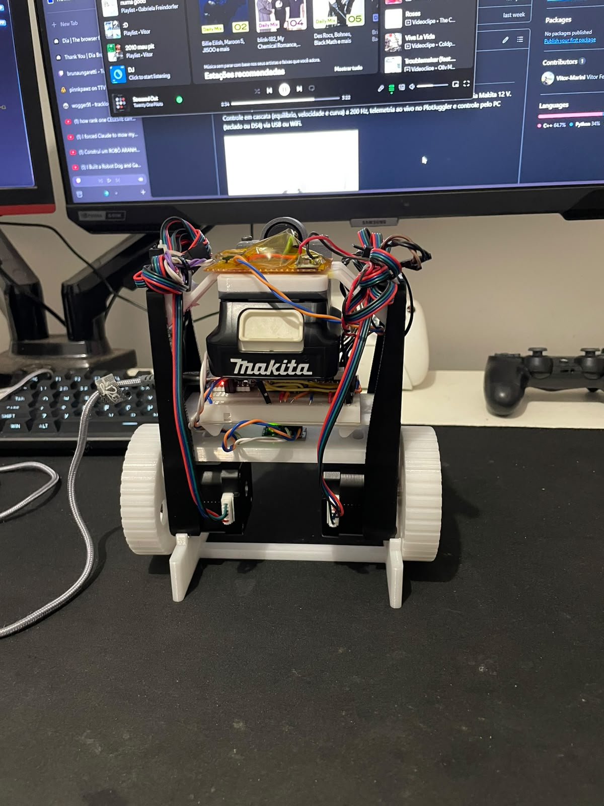
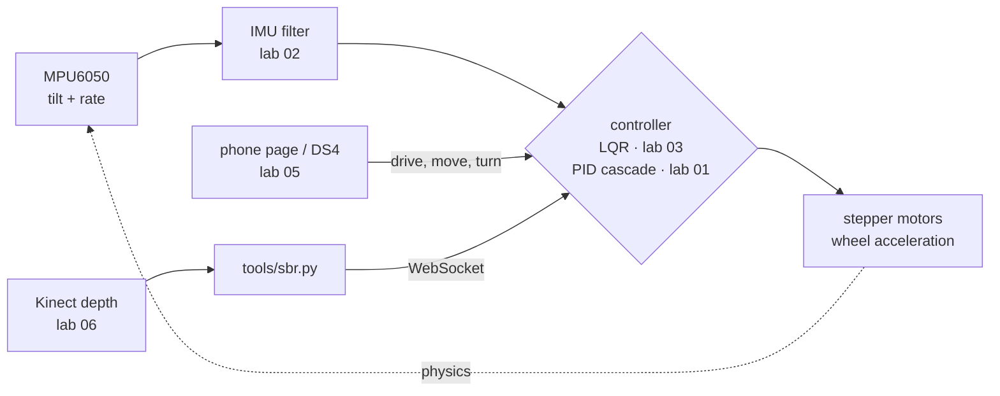

# S.B.R — Self-Balancing Robot

A two-wheeled self-balancing robot built as a **study platform**: each technology it explores (control theory,
sensor fusion, computer vision, simulation, learning) lives in its own **lab**, with the theory, the code and the
numbers measured on the real robot.

ESP32-C3 + MPU6050 + 2× NEMA17 steppers (DRV8825, 1/16), Makita 12 V battery. Balances with **LQR** at 200 Hz,
drives from a phone page or a DS4, and can be driven by programs through a small Python SDK.

| mk1 | mk2 (current) |
|---|---|
|  |  |

## How it fits together



## Labs

| # | Lab | What it is about | Status |
|---|-----|------------------|--------|
| 01 | [PID and cascade control](labs/01-pid-cascade/) | PD balance + speed/position loops stacked on top | ✅ works, replaced by LQR |
| 02 | [IMU filter](labs/02-imu-filter/) | complementary filter, gyro zero tracked while balancing | ✅ in use |
| 03 | [LQR](labs/03-lqr/) | state feedback from a physical model; simulation before the robot | ✅ **default controller** |
| 04 | [Odometry calibration](labs/04-odometry-calibration/) | gyro scale, wheel track, the 5-turn test | ✅ demo returns within 0.5 cm |
| 05 | [Web control](labs/05-web-control/) | the robot serves a control page; WebSocket; Gamepad API | ✅ in use |
| 06 | [Kinect navigation](labs/06-kinect-navigation/) | depth camera: floor plane, robot tracking, click-to-go | ⏸ works, paused |
| 07 | [MuJoCo + reinforcement learning](labs/07-mujoco-rl/) | simulate the robot, train a policy, compare with LQR | ⏸ paused · best policy v3 ran on the robot |
| 08 | [Isaac Lab](labs/08-isaac-lab/) | the same robot, thousands at once on the RTX GPU | 🟡 v7 residual: best so far, not for the robot yet |

## Repository

```
firmware/   PlatformIO project for the ESP32-C3 (src/, include/, test/)
tools/      everyday PC tools: SDK (sbr.py), serial/WiFi bridge, gamepad, teleop, log analysis
labs/       one folder per technology: README (theory → code → results → lessons) + its scripts
model/      the robot's physical sheet (params.json) + generators for simulators (MuJoCo now, Isaac later)
docs/       getting started, hardware, journal (dated log of every test), history (past plans)
hardware/   3D models of the chassis (Fusion 360) + printables/ (tags and calibration board, `tools/make_tags.py`)
media/      photos (mk1, mk2)
```

## Quick start

```bash
~/.platformio/penv/bin/pio run -d firmware -t upload     # flash (robot on its stand)
# phone: open http://sbr.local
tools/sbr.sh                                              # or PC: PlotJuggler + terminal over WiFi
```

Full guide: [docs/getting-started.md](docs/getting-started.md) · Hardware: [docs/hardware.md](docs/hardware.md) ·
Everything that was tried, in order: [docs/journal.md](docs/journal.md).

The mk1 firmware is at the git tag `mk1`.
