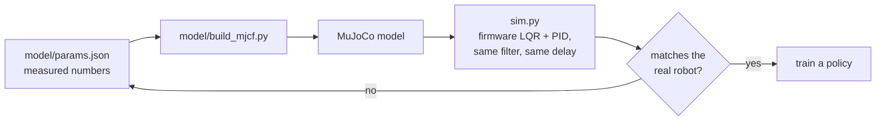

# Lab 07 — MuJoCo + reinforcement learning

> **In one sentence:** a physics simulator of the robot, trustworthy because it reproduces the real robot with the
> real controllers — the playground where a neural network can learn to balance.

**Status:** 🟡 simulator validated · policy trained (matches LQR in simulation). Next: run it on the ESP32-C3.

## Why simulate first

Training a policy needs millions of attempts — and falls. On the real robot that's days and broken parts; in MuJoCo
it's minutes. But a policy is only as good as the simulator it learned in, so **step 1 is proving the simulator is
honest**: run the exact firmware controllers in it and compare with what the robot did.



## The model

One source of truth: [`model/params.json`](../../model/params.json) (MuJoCo now, Isaac Sim later). Everything in it
was measured or is marked as a guess.

| Piece | How it's modeled |
|---|---|
| Body | 1.02 kg, CoM 37 mm above the axle, pitch inertia from the **measured L = 0.09 m** (`I = L·m·d`) |
| Wheels | 37 mm radius, 150 mm track, hinge on the body, floor friction 0.8 |
| Stepper | **velocity servo** on each wheel (it follows the commanded speed), torque-limited at 0.3 N·m (*guess*): past it the wheel can't follow — the sim's version of a missed step |
| IMU | MuJoCo gyro + accelerometer at the real chip height, the firmware's complementary filter, 1-tick delay, 0.3 °/s gyro noise |
| "Dirt" | random pitch torque (0.008 N·m) for motor vibration, backlash, floor — calibrated below |

### Lessons from building it

- **A too-stiff motor model shook the robot down.** The first velocity servo (gain 5 N·m per rad/s) on a 20 g wheel
  slammed into the torque limit every millisecond. The LQR looked broken; it wasn't. Gain 0.2 + realistic rotor/hub
  inertia (5e-5 kg·m²) tracks within 0.01 cm/s and is numerically clean.
- **The simulator was too clean.** Without disturbances it stood perfectly still. One random torque, calibrated
  against the real wobble, made **both** controllers match the robot at once — a good sign the physics is right.

## Validation (`sim.py`)

| | Real robot | Simulator |
|---|---|---|
| PID, standing still | ±2.5–4 cm | ±3.5–4.6 cm |
| LQR, standing still | ±0.3–1 cm | ±0.5–0.7 cm |
| PID, `move 50` | overshoot 3–15 cm, 6–25 s | 19 cm, 13 s |
| LQR, `move 50` | ~1 cm, 4.8 s | 1.4 cm, 4.0 s |
| pitch jitter | ~±0.2° | ±0.15° |

Pushes (0.1 s at the top): PID survives up to 4 N, LQR up to 6 N — same order as on the real robot, where LQR handles
pushes better and a hard hit that saturates the wheel speed knocks it down.

## Run it

```bash
python3 -m venv --system-site-packages .venv                                                    # once
.venv/bin/pip install torch --index-url https://download.pytorch.org/whl/cpu                    # CPU-only torch (~200 MB)
.venv/bin/pip install "mujoco==3.17.0" "gymnasium==1.0.0" "stable-baselines3==2.4.1" "numpy==1.24.4"  # numpy <1.25: system SciPy
.venv/bin/python model/build_mjcf.py                  # writes model/sbr.xml (optional: python -m mujoco.viewer --mjcf model/sbr.xml)
.venv/bin/python labs/07-mujoco-rl/sim.py             # validation report (~2 s)
.venv/bin/python labs/07-mujoco-rl/sim.py view        # 3D, real time, LQR: P push · M move +50 cm · N move −50 cm
.venv/bin/python labs/07-mujoco-rl/sim.py view pid    # same with the PID cascade
```

## Step 2: training a policy (`env.py`, `train.py`)

The network replaces exactly the LQR's job: every 5 ms it gets what the firmware measures (filtered pitch, pitch
rate, wheel speed, position error, last action) and outputs a wheel acceleration (±4 m/s², the firmware cap).
Reward = 1 per step standing − the LQR's own cost (Bryson weights). Each episode is a slightly different robot
(L ±20 %, mass ±10 %, torque 0.2–0.4 N·m, friction 0.5–1.0, noise, dirt) with random pushes up to 6 N.

PPO, 2×32 network, 3M steps on 8 CPU processes: **~6 minutes**.

| episode length (10 s = never falls, with random pushes) | 0.3M: 2.3 s · 0.9M: 6.5 s · 2.1M: 7.4 s · 3.0M: 8.3 s |
|---|---|

| | still: x range | pitch jitter | biggest push | 20 random robots |
|---|---|---|---|---|
| LQR as a policy | ±0.6 cm | ±0.43° | 4 N | 20/20 stand |
| **PPO policy** | ±1.1 cm | **±0.18°** | 4 N | **20/20 stand** |

A network that knows no physics matched the LQR in minutes: firmer body, a bit more drift (the reward weights
decide that trade). Watch it: `.venv/bin/python labs/07-mujoco-rl/train.py view` (P push · L LQR/policy · R random robot).

## Step 3: sim-to-real, round 1 → v2 → v3

**First real test (v1):** the network balanced the real robot for **28 s** on its first try — but with a constant
+2.75° setpoint error (the gyro-zero transient right after calibration) it sat ~10 cm off its reference, and a light
push made it over-correct into a growing oscillation and fall. The simulator never had a wrong setpoint.

Each gap the real robot shows becomes something randomized in training:

| | v1 | v2 | v3 |
|---|---|---|---|
| setpoint error | 0 | ±3° | ±3° |
| sensor delay | 5 ms | 5–15 ms | 5–15 ms |
| pushes | ±6 N, 0.1 s, every ~2 s | ±8 N, 0.05–0.2 s, ~2 s | ±6 N, 0.05–0.2 s, ~3.5 s |
| position weight `W_X` | 0.05 | 0.05 | 0.03 |
| firmware position limit (9 cm) | no | yes | yes |

| | still: x range | pitch jitter | push | 20 random robots | setpoint +2.75° + push |
|---|---|---|---|---|---|
| LQR | ±0.6 cm | ±0.43° | 6 N | 20/20 | 4 N |
| v1 | ±1.1 cm | ±0.18° | 4 N | 20/20 | 4 N |
| v2 | **±23 cm** | ±0.17° | 4 N | 20/20 | **6 N** |
| **v3** | **±0.6 cm** | ±0.19° | 4 N | 20/20 | 4 N |

**v2's lesson:** with frequent 8 N pushes it fell so often that "don't fall" was all that paid — holding position
stopped mattering and it wandered ±23 cm. The reward and the randomization decide what is learned. v3 (fewer, softer
pushes, stronger position weight) holds its place like the LQR.

**On the ESP32-C3** (no FPU): the network in float took **3.2 ms** (budget: 5 ms for the whole loop); with a tanh
table 2.2 ms; in **fixed point** (Q12 int16 weights, int32 sums, hardware multiply) **103 µs**. `export.py` checks
the C against PyTorch (max error ~1e-3).

## Step 4: v4 — "a day of use" (`env.py` v4, `train.py`)

Second floor test (v3): it drove 4 m at 0.4 m/s with turns — never trained to drive — but jerked at every joystick
change and, after a push, fell into the same ±4 m/s² bang-bang oscillation as v1. v4 trains everything the robot lives:

| | |
|---|---|
| scenarios | still · joystick driver (speed steps to ±0.4 m/s, reversals, stops, turns) · move/turn · mixed |
| world | pushes, tile grout (wheels resisted 20–80 ms), slope ±2°, drifting setpoint error ±3°, sensor delay 5–15 ms, wheel lag 0–10 ms, robot randomization |
| observation | 3 frames × 8: tilt − θref, rate, v − v_ref, position error, v_ref, a_ref, turn command, last action |
| reward | LQR-style cost around the reference + **jerk** (Δaction) |
| curriculum | difficulty 0.2 → 1 over the first 60 % |
| network / run | 2×64, 30M steps, 32 processes (7.7k steps/s), 58 min |

Test battery (copies the real tests; the LQR is the bar):

| test | LQR | v4 20M (best) | v4 30M |
|---|---|---|---|
| still | ±0.7 cm ±0.43° | ±0.9 cm **±1.56°** | ±1.3 cm ±1.58° |
| still, setpoint +2.75° | ±0.7 cm ±0.43° | ±0.9 cm ±1.57° | ±1.0 cm ±1.57° |
| joystick drive (real test) | max tilt 9.4° | 9.4° | 9.2° |
| demo | 9.6 cm off | 10.4 cm | 9.3 cm |
| push ladder | 6 N | 6 N | 6 N |
| grout at 0.3 m/s | max tilt 9.0° | 9.6° | 9.0° |
| 50 random robots | **32/50** | 27/50 | 18/50 |

**Not good enough for the robot yet:** it ties the LQR on driving, the demo, pushes and grout, but its body shakes
~4× more standing (±1.6° vs ±0.4°) and it survives fewer random robots. Training reward kept falling once difficulty
hit 1 (episodes ~9 of 15 s): the full world is too hard to keep improving in, and later checkpoints got worse.

Suspected causes, to fix before training again:
1. **Clipped reward:** `1 − min(1, 0.05·cost)` is flat at 0 whenever cost > 20 — in hard moments (exactly when it
   matters) the network gets no signal about doing *less* badly. Use a smooth shape, e.g. `exp(−cost/20)`.
2. **Difficulty 1 is beyond the LQR itself** (32/50): cap the curriculum where the LQR still survives most episodes.
3. **Shaking:** tilt is weighted loosely (8°) next to everything else; jitter isn't penalized directly.

## Next

1. ✅ Gymnasium environment with domain randomization. 2. ✅ PPO, compared with LQR.
3. ✅ Exported to C (fixed point), runs as `ctl rl`; v1 balanced 28 s on the real robot. Next: v3 on the floor.
4. Later: the same `model/params.json` → URDF → Isaac Sim on the RTX 4060 Ti machine (lab 08).
