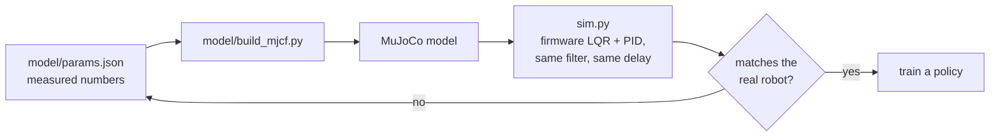

# Lab 07 — MuJoCo + reinforcement learning

> **In one sentence:** a physics simulator of the robot, trustworthy because it reproduces the real robot with the
> real controllers — the playground where a neural network can learn to balance.

**Status:** 🟡 simulator validated · policy trained (matches LQR in simulation). Next: run it on the ESP32-C3.

## Why simulate first

Training a policy needs millions of attempts — and falls. On the real robot that's days and broken parts; in MuJoCo
it's minutes. But a policy is only as good as the simulator it learned in, so **step 1 is proving the simulator is
honest**: run the exact firmware controllers in it and compare with what the robot did.



## The model

One source of truth: [`model/params.json`](../../model/params.json) (MuJoCo now, Isaac Sim later). Everything in it
was measured or is marked as a guess.

| Piece | How it's modeled |
|---|---|
| Body | 1.02 kg, CoM 37 mm above the axle, pitch inertia from the **measured L = 0.09 m** (`I = L·m·d`) |
| Wheels | 37 mm radius, 150 mm track, hinge on the body, floor friction 0.8 |
| Stepper | **velocity servo** on each wheel (it follows the commanded speed), torque-limited at 0.3 N·m (*guess*): past it the wheel can't follow — the sim's version of a missed step |
| IMU | MuJoCo gyro + accelerometer at the real chip height, the firmware's complementary filter, 1-tick delay, 0.3 °/s gyro noise |
| "Dirt" | random pitch torque (0.008 N·m) for motor vibration, backlash, floor — calibrated below |

### Lessons from building it

- **A too-stiff motor model shook the robot down.** The first velocity servo (gain 5 N·m per rad/s) on a 20 g wheel
  slammed into the torque limit every millisecond. The LQR looked broken; it wasn't. Gain 0.2 + realistic rotor/hub
  inertia (5e-5 kg·m²) tracks within 0.01 cm/s and is numerically clean.
- **The simulator was too clean.** Without disturbances it stood perfectly still. One random torque, calibrated
  against the real wobble, made **both** controllers match the robot at once — a good sign the physics is right.

## Validation (`sim.py`)

| | Real robot | Simulator |
|---|---|---|
| PID, standing still | ±2.5–4 cm | ±3.5–4.6 cm |
| LQR, standing still | ±0.3–1 cm | ±0.5–0.7 cm |
| PID, `move 50` | overshoot 3–15 cm, 6–25 s | 19 cm, 13 s |
| LQR, `move 50` | ~1 cm, 4.8 s | 1.4 cm, 4.0 s |
| pitch jitter | ~±0.2° | ±0.15° |

Pushes (0.1 s at the top): PID survives up to 4 N, LQR up to 6 N — same order as on the real robot, where LQR handles
pushes better and a hard hit that saturates the wheel speed knocks it down.

## Run it

```bash
python3 -m venv --system-site-packages .venv && .venv/bin/pip install "mujoco==3.17.0" "numpy<2"   # once
.venv/bin/python model/build_mjcf.py                  # writes model/sbr.xml (optional: python -m mujoco.viewer --mjcf model/sbr.xml)
.venv/bin/python labs/07-mujoco-rl/sim.py             # validation report (~2 s)
.venv/bin/python labs/07-mujoco-rl/sim.py view        # 3D, real time, LQR: P push · M move +50 cm · N move −50 cm
.venv/bin/python labs/07-mujoco-rl/sim.py view pid    # same with the PID cascade
```

## Step 2: training a policy (`env.py`, `train.py`)

The network replaces exactly the LQR's job: every 5 ms it gets what the firmware measures (filtered pitch, pitch
rate, wheel speed, position error, last action) and outputs a wheel acceleration (±4 m/s², the firmware cap).
Reward = 1 per step standing − the LQR's own cost (Bryson weights). Each episode is a slightly different robot
(L ±20 %, mass ±10 %, torque 0.2–0.4 N·m, friction 0.5–1.0, noise, dirt) with random pushes up to 6 N.

PPO, 2×32 network, 3M steps on 8 CPU processes: **~6 minutes**.

| episode length (10 s = never falls, with random pushes) | 0.3M: 2.3 s · 0.9M: 6.5 s · 2.1M: 7.4 s · 3.0M: 8.3 s |
|---|---|

| | still: x range | pitch jitter | biggest push | 20 random robots |
|---|---|---|---|---|
| LQR as a policy | ±0.6 cm | ±0.43° | 4 N | 20/20 stand |
| **PPO policy** | ±1.1 cm | **±0.18°** | 4 N | **20/20 stand** |

A network that knows no physics matched the LQR in minutes: firmer body, a bit more drift (the reward weights
decide that trade). Watch it: `.venv/bin/python labs/07-mujoco-rl/train.py view` (P push · L LQR/policy · R random robot).

## Next

1. ✅ Gymnasium environment with domain randomization. 2. ✅ PPO, compared with LQR.
3. Export the small network to C, time it on the ESP32-C3 (no FPU), try it on the robot as `ctl rl`.
4. Later: the same `model/params.json` → URDF → Isaac Sim on the RTX 4060 Ti machine (lab 08).
