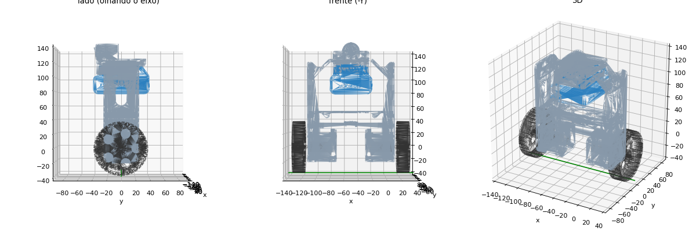

# Meshes from the Fusion 360 model (S.B.R mk2)

Exported from the real robot's CAD: `body.stl`, `wheel_left.stl`, `wheel_right.stl` (each with its steel motor shaft,
which spins with the wheel), `battery.stl` (Makita CXT 12 V, mounted on top — the deepest part of the robot, the first
thing to hit the floor in a fall). Millimetres, one shared assembly frame: +Z up, X along the axle (+X = left wheel),
−Y = front (power switch side), axle center at (−50.05, −0.26, 0), floor at z = −37.5.

**Geometry only.** Masses and inertias in the CAD are estimates; the simulators take physics from
[`../params.json`](../params.json) (measured: 1.02 kg, CoM 37 mm, pendulum L = 0.09 m), which agree with the CAD
estimate within 15 %. `info.json` has the CAD numbers; `cad-notes.md` (Portuguese) is the exporting agent's notes.

